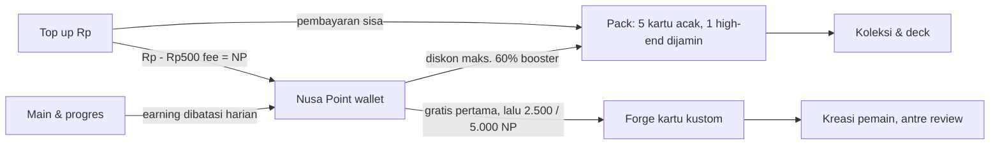
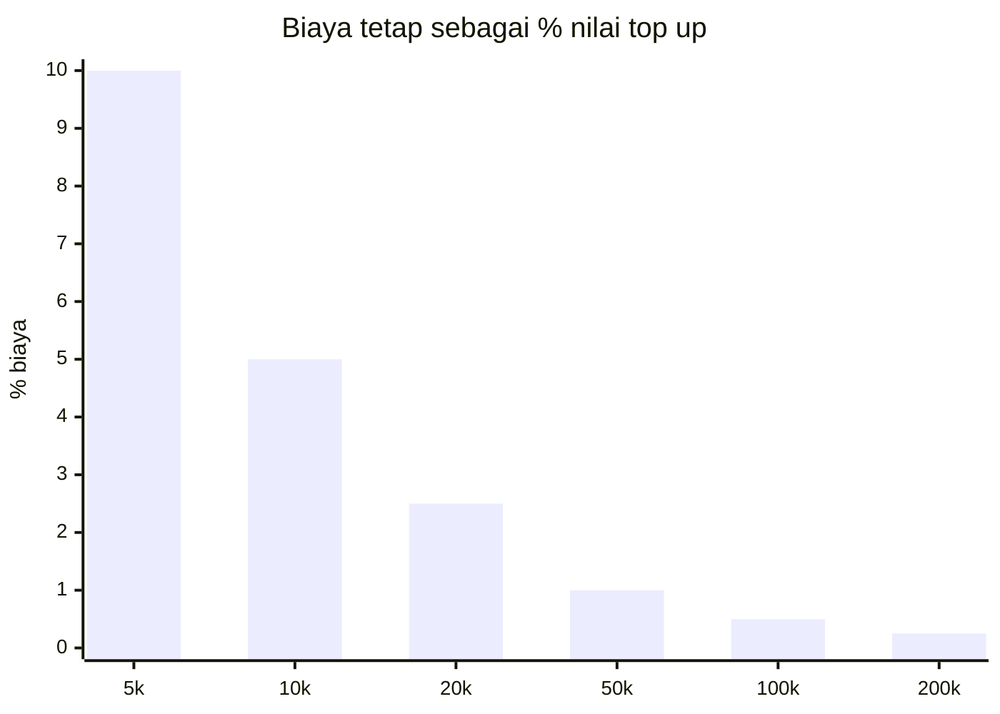
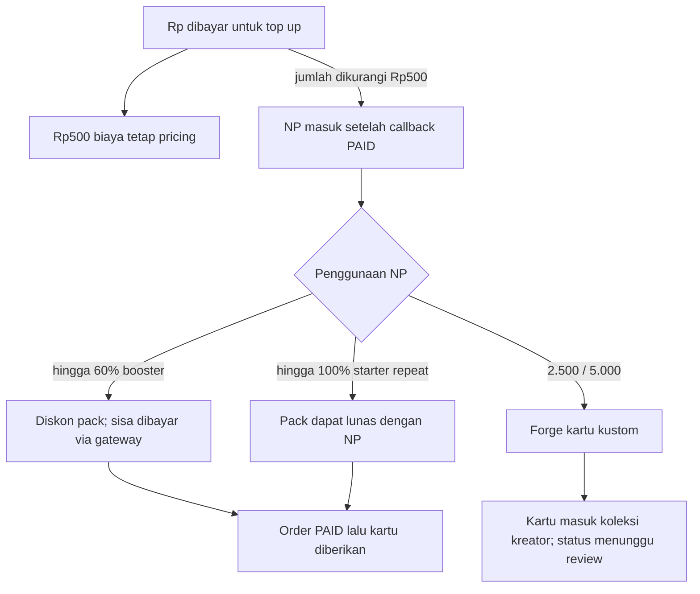

# Nusantara Card — Economic Value
### Pitch deck berbasis logic produk saat ini

> **Status analisis:** angka harga, biaya, batas, dan alur di bawah dibaca dari kode saat ini. Proyeksi dan saran produk ditandai sebagai **ilustrasi/usulan**, bukan performa bisnis aktual. Repository belum menyediakan data transaksi agregat, biaya gateway, pajak, atau biaya akuisisi untuk menghitung margin dan LTV aktual.

---

## 01 — Thesis

**Nusa Point menghubungkan tiga loop nilai:** pemain mendapat poin dengan bermain, mengubah poin menjadi koleksi melalui pack, atau menjadi ekspresi/UGC melalui forge. Top up menjual jalan pintas yang transparan: Rp1 nominal = 1 NP, dikurangi biaya tetap Rp500 per transaksi.



**Pitch:** monetisasi menjual akses koleksi dan alat kreasi; daya saing tetap dijaga dengan starter gratis, hadiah bermain, batas diskon poin, dan batas Battle Point.

---

## 02 — Produk yang menghasilkan nilai

| Jalur | Harga/biaya di kode | Nilai yang diterima | Batas utama |
|---|---:|---|---|
| Starter pack | Rp20.000 setelah klaim pertama | 20 kartu tetap: 8 karakter + 12 instrumen | Gratis diklaim sekali; setelahnya dapat dibayar dengan uang atau NP sampai 100% harga |
| Booster Majapahit | Rp15.000 | 5 kartu acak, 1 kartu High-End dijamin | NP menutup maks. 60% (9.000 NP); sisa minimal Rp6.000 |
| Booster Pajajaran | Rp15.000 | 5 kartu acak, 1 kartu High-End dijamin | NP menutup maks. 60% (9.000 NP); sisa minimal Rp6.000 |
| Booster instrumen | Rp12.000 | 5 instrumen acak, 1 High-End dijamin | NP menutup maks. 60% (7.200 NP); sisa minimal Rp4.800 |
| Top up | Rp5.000–Rp200.000 per tier | Nominal dikurangi Rp500 diberikan sebagai NP | Hanya akun terdaftar; 9 tier tetap |
| Forge kartu kustom | Kartu pertama 0 NP; kedua 2.500 NP; berikutnya 5.000 NP/kartu | Kartu milik kreator; dikirim dengan status custom `PENDING` untuk review | Maksimum 2.100 BP total; ATK dan DEF minimal 100 |

**Catatan pack:** booster memakai pengundian acak dengan pengembalian (duplikat dimungkinkan); slot pertama diambil dari pool High-End dan empat slot berikutnya dari pool umum. Jaminan High-End berlaku per pack, bukan jaminan kartu tertentu.

**Catatan alur:** bila pack dibayar seluruhnya dengan NP, server langsung menandai order lunas dan memberikan kartu. Jika masih ada sisa rupiah, pembayaran melalui gateway diperlukan; kartu diberikan setelah status pembayaran sukses.

---

## 03 — Unit value pack

Harga berikut adalah **harga nominal sebelum diskon NP**. Untuk booster dengan batas diskon penuh, pemain membayar 40% harga pack dengan rupiah.

| Pack | Harga | Kartu | Rupiah per kartu (nominal) | NP maks. | Sisa tunai minimum |
|---|---:|---:|---:|---:|---:|
| Starter (repeat) | Rp20.000 | 20 | Rp1.000 | 20.000 (100%) | Rp0 |
| Majapahit | Rp15.000 | 5 | Rp3.000 | 9.000 (60%) | Rp6.000 |
| Pajajaran | Rp15.000 | 5 | Rp3.000 | 9.000 (60%) | Rp6.000 |
| Instrumen | Rp12.000 | 5 | Rp2.400 | 7.200 (60%) | Rp4.800 |

```text
Nominal pack per kartu (Rp)   0      1.000     2.000     3.000
Starter repeat (20 kartu)     ██████████ 1.000
Majapahit (5 kartu)           ██████████████████████████████ 3.000
Pajajaran (5 kartu)           ██████████████████████████████ 3.000
Instrumen (5 kartu)           ████████████████████████ 2.400
```

**Cara membaca:** pack 5 kartu memberi harga nominal/kartu lebih tinggi dari starter tetap; pembelian booster menukar kepastian isi dengan variasi tema dan jaminan minimal satu kartu High-End. Ini bukan ukuran nilai koleksi pasar sekunder—tidak ada fitur jual/beli antar pemain yang diperhitungkan di sini.

---

## 04 — Top up: proposisi dan ekonomi poin

Aturan yang diimplementasikan: **NP diberikan = nilai top up − Rp500**. Karena biayanya tetap, persentase biaya efektif mengecil saat nominal naik. Tidak ada bonus poin volume di tabel tier saat ini.

```text
Nominal top up → poin diterima → biaya efektif → nilai 1 NP bagi pembeli
Rp   5.000     →      4.500    →    10,00%    → Rp1,111
Rp  10.000     →      9.500    →     5,00%    → Rp1,053
Rp  20.000     →     19.500    →     2,50%    → Rp1,026
Rp  50.000     →     49.500    →     1,00%    → Rp1,010
Rp 100.000     →     99.500    →     0,50%    → Rp1,005
Rp 200.000     →    199.500    →     0,25%    → Rp1,003
```



**Implikasi:** tier kecil lebih mudah dicoba, namun fee terasa jauh lebih besar. Tier tinggi memberi konversi lebih baik tanpa bonus yang membebani ekonomi poin. Fee Rp500 adalah fee dalam pricing aplikasi; belum tentu sama dengan fee gateway atau pendapatan bersih.

---

## 05 — Forge sebagai sink poin dan loop kreasi

| Kartu kustom ke- | Biaya | Nilai nominal setara | Maks. hari earning jika cap harian 500 NP tercapai |
|---:|---:|---:|---:|
| 1 | 0 NP | Rp0 | 0 |
| 2 | 2.500 NP | Rp2.500 | 5 |
| 3+ | 5.000 NP | Rp5.000 | 10 |

```text
Biaya forge (NP)        0         1.250      2.500      3.750      5.000
Kartu pertama           · (free)
Kartu kedua             ███████████████ 2.500
Kartu ketiga+           ██████████████████████████████ 5.000
```

Earning harian yang tampak di policy: **total maksimum 500 NP**, dengan sub-cap bot 100, Story 100, PvP/League 400; aturan sumber/cooldown tambahan berlaku. Maka biaya forge kartu ke-2 setara **5 hari** pada maksimum harian dan kartu ke-3+ setara **10 hari**. Ini adalah ekuivalen waktu teoritis; pemain juga dapat membeli NP, dan progres nyata bergantung pada aktivitas serta eligibility.

**Nilai produk:** kartu pertama menghilangkan hambatan mencoba forge; biaya bertingkat membuat kreasi berulang menjadi sink NP. Kartu memakai batas 2.100 BP untuk mencegah kenaikan stat tanpa batas. Forge tidak otomatis menjadi pendapatan tunai: hanya transaksi top up yang dapat menimbulkan pembayaran eksternal.

---

## 06 — Dari rupiah ke nilai yang dipakai



Settlement top up bersifat berbasis callback: order dibuat `PENDING`; NP baru dicatat saat status beralih ke `PAID`. Pencatatan menggunakan order ID sebagai sumber transaksi agar dapat ditelusuri. Pembelian pack juga mencatat NP yang dipakai sebagai transaksi negatif.

---

## 07 — Rekomendasi implementasi ekonomi

### P0 — Jadikan satu ledger sebagai sumber kebenaran

- Catat event bertipe `TOPUP`, `SHOP_ORDER_SPEND`, `CUSTOM_CARD_MINT`, dan reward gameplay dalam ledger yang sama; simpan ID order/kartu, nominal, timestamp, dan payment mode.
- Pastikan callback gateway idempotent, amount cocok dengan order, dan NP hanya diberikan untuk order yang benar-benar `PAID`.
- Tambahkan audit rekonsiliasi: total rupiah paid, NP diterbitkan, NP dibelanjakan, refund/reversal, serta saldo agregat.

### P1 — Ukur conversion dan sink sebelum mengubah harga

Instrumen minimum yang disarankan: `shop_view → pack_selected → checkout_started → payment_paid/failed`, `topup_tier_selected → topup_paid`, `forge_started → forge_paid/created → review_approved/rejected`. Sertakan `user_id` pseudonim, `order_id`, SKU/tier, diskon NP, rupiah bruto, mode DEV/PROD, hasil pembayaran dan waktu. Hindari mengirim data artwork/deskripsi kartu ke analytics.

### P2 — Tampilkan nilai dengan jujur

- Pada top up tampilkan **dibayar, fee Rp500, NP diterima** dan rasio biaya efektif sebelum checkout.
- Pada booster tampilkan peluang/aturan pool secara transparan; sekarang kode menjamin minimal satu High-End, tetapi tidak menyatakan peluang detail dan mengizinkan duplikat.
- Tampilkan harga nominal, batas NP, sisa tunai, serta label status pembayaran DEV/PROD. Perubahan dari DEV ke PROD perlu dimonitor per order.

### KPI ekonomi yang dapat diturunkan

| KPI | Rumus |
|---|---|
| Paid conversion | unique payer / unique shop viewer |
| ARPPU | rupiah paid pack + top up / unique payer |
| Top up tier mix | paid top ups per tier / all paid top ups |
| Point utilization | NP terpakai / NP diterbitkan dalam cohort/periode |
| Earn-to-spend coverage | NP gameplay terpakai / NP gameplay diterbitkan |
| Forge activation | kreator forge pertama / pemain aktif |
| Forge repeat | kreator dengan forge ke-2+ / kreator forge pertama |
| Net revenue | pembayaran settled − refund − biaya gateway − pajak/biaya lain |

Jangan menjumlahkan `amountIdr` order pack dan top up tanpa memperhatikan status: gunakan order `PAID` saja dan pisahkan rupiah dibayar dari `pointsSpent` agar satu belanja tidak terhitung ganda.

---

## 08 — Pitch penutup

**Model saat ini sudah mempunyai tiga komponen yang saling melengkapi:**

1. **Pack** menangkap willingness-to-pay untuk koleksi tematik dengan jaminan High-End dan diskon poin terbatas.
2. **Top up** mengubah kebutuhan poin menjadi transaksi dengan biaya nominal sederhana dan tier tetap.
3. **Forge** memberi tujuan emosional bagi poin, memperpanjang progres, dan membuka kontribusi pemain.

**Keputusan berikutnya:** jalankan funnel pengukuran, rekonsiliasi paid orders dan ledger, lalu uji komposisi tier/pack dengan data cohort. Hindari klaim revenue, margin, atau LTV sebelum payment mode produksi, biaya aktual, refund, dan volume transaksi tersedia.

---

## Lampiran — Rujukan implementasi

- Katalog dan harga pack: [`instruments-catalog.ts`](../src/core/constants/instruments-catalog.ts)
- Aturan pengundian booster dan jaminan High-End: [`pack-tiers.ts`](../src/core/constants/pack-tiers.ts)
- Aturan reward/cap Nusa Point, konversi nominal, dan biaya forge: [`nusa-point-policy.ts`](../src/server/modules/nusa-points/domain/nusa-point-policy.ts)
- Tier top up dan fee: [`topup-policy.ts`](../src/server/modules/payment/domain/topup-policy.ts)
- Checkout pack serta batas diskon: [`shop.usecase.ts`](../src/server/modules/shop/application/shop.usecase.ts)
- Checkout top up dan callback issuance: [`topup.usecase.ts`](../src/server/modules/payment/application/topup.usecase.ts), [`topup.repository.impl.ts`](../src/server/modules/payment/infrastructure/topup.repository.impl.ts)
- Pricing/validasi forge dan konsumsi poin: [`custom-card.usecase.ts`](../src/server/modules/card/application/custom-card.usecase.ts)
- Arsitektur pembayaran awal di PRD: [`PRD_Nusantara_Card.md`](./PRD_Nusantara_Card.md)

*Semua angka harga/aturan mengacu pada source saat pemeriksaan. Nilai setara Rp untuk poin adalah nilai nominal sesuai kebijakan `idrPerPoint: 1`; nilai ekonomi bersih berbeda karena fee top up, biaya gateway, dan struktur biaya belum dimasukkan.*
